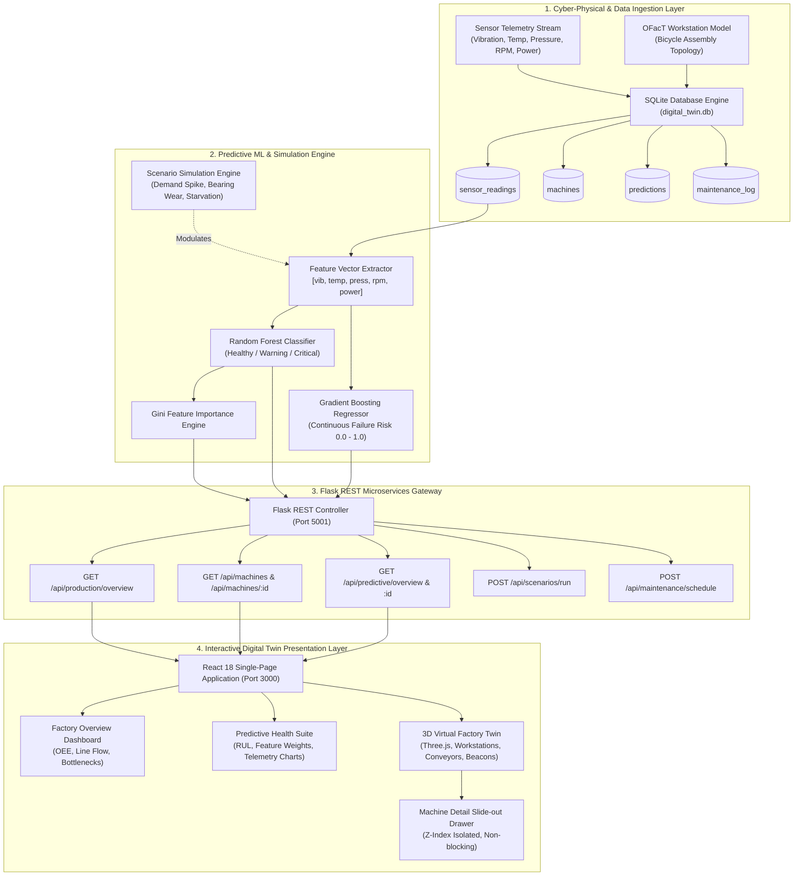
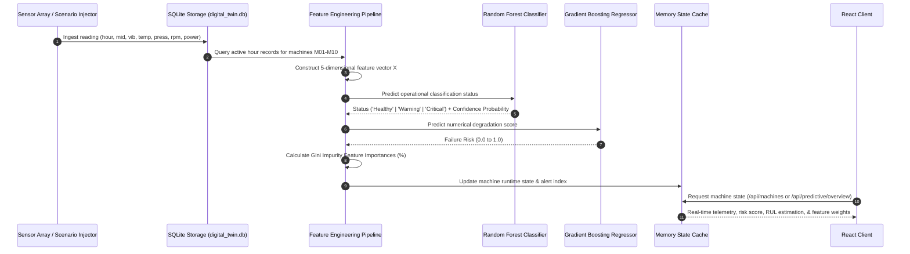
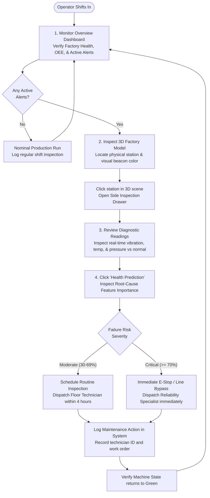

# End-to-End Architecture & Technical Flow Specification
## Open-Source Digital Twin Framework for Manufacturing: Production Monitoring, Predictive Analysis, and 3D Machine Visualization

---

## 1. Executive Summary

This document specifies the complete end-to-end architecture, data pipelines, predictive machine learning models, simulation engine, and 3D digital twin rendering pipeline for the **FactoryTwin** manufacturing system. 

The digital twin establishes a bi-directional cyber-physical bridge between factory floor operations and operational intelligence. It monitors 10 discrete manufacturing workstations across 6 production stages, runs real-time inference using ensemble machine learning models, and renders a photorealistic, interactive 3D WebGL digital twin with responsive telemetry and closed-loop maintenance workflows.

---

## 2. Multi-Tier System Architecture

The application is structured into four decoupled layers:
1. **Cyber-Physical Simulation & Data Layer**: High-frequency multi-sensor telemetry, SQLite relational persistence, and OFacT manufacturing ontology.
2. **Predictive Analytics & Intelligence Engine**: Supervised machine learning ensemble (Random Forest Classifier & Gradient Boosting Regressor) with feature importance attribution.
3. **REST API Gateway**: High-throughput Flask microservices exposing state endpoints, scenario modulation, and maintenance logs.
4. **Interactive Digital Twin Frontend**: React 18 single-page application with Three.js / React Three Fiber 3D spatial canvas, SVG dynamic flow diagrams, and Recharts operational telemetry.



### Architecture Layer Descriptions

- **Cyber-Physical & Data Ingestion Layer**: Consolidates historical and real-time sensor streams representing 480 operational shifts. Raw physical parameters are recorded with microsecond timestamps and validated against baseline operating envelopes before committing to normalized relational tables.
- **Predictive ML & Simulation Engine**: Executes dual model inference. Rather than using static threshold alarms, it evaluates multidimensional feature cross-correlations to predict equipment degradation before physical failure occurs.
- **Flask REST Gateway**: Provides CORS-enabled, low-latency JSON endpoints. It abstracts database queries and predictive inference, returning unified machine state objects with nominal vs. observed variance.
- **Presentation Layer**: Built with React 18 and Vite. It provides seamless navigation between macro-level factory KPIs, micro-level sensor telemetry, and a fully interactive 3D spatial model.

---

## 3. Data Ingestion, Storage & Machine Learning Pipeline



### Detailed Pipeline Breakdown

1. **Feature Vector Extraction**:
   At each operational cycle $t$, five continuous physical telemetry features are gathered for workstation $m$:
   $$\mathbf{X}_m = [v_m, T_m, P_m, \omega_m, W_m]$$
   where $v$ is vibration amplitude ($\text{mm/s}$), $T$ is core operating temperature ($^\circ\text{C}$), $P$ is hydraulic/pneumatic pressure ($\text{bar}$), $\omega$ is rotational velocity ($\text{RPM}$), and $W$ is electrical power consumption ($\text{kW}$).

2. **Classification (Random Forest)**:
   - **Configuration**: 60 decision trees, maximum tree depth of 8, Gini impurity criterion.
   - **Target**: Discrete state classification:
     $$\hat{y}_{\text{class}} \in \{\text{Healthy}, \text{Warning}, \text{Critical}\}$$
   - **Soft Voting**: Computes class confidence probabilities $P(\text{class} \mid \mathbf{X})$ to ensure nuanced operator notifications.

3. **Regression (Gradient Boosting)**:
   - **Configuration**: 50 boosting stages, learning rate $\eta = 0.1$, maximum tree depth of 5, least-squares loss.
   - **Target**: Continuous failure risk score:
     $$R_m = \min(1.0, \max(0.0, \hat{y}_{\text{reg}}))$$
   - Maps directly to the Health Index ($H_m = 100 \times (1 - R_m)$) and Remaining Useful Life (RUL) estimation.

4. **Root-Cause Attribution via Gini Importance**:
   Feature importances are evaluated across all ensemble tree splits:
   $$I(f) = \frac{\sum_{t \in T} \Delta i(t, f)}{\sum_{f'} \sum_{t \in T} \Delta i(t, f')}$$
   The resulting percentages immediately inform maintenance technicians which physical parameter (e.g., thermal spike vs. abnormal vibration) is driving machine degradation.

---

## 4. Physical-to-Virtual Mapping & 3D Digital Twin Pipeline

The 3D factory scene is constructed using Three.js and React Three Fiber. Each workstation is rendered at its calibrated coordinate corresponding to its physical layout on the factory floor.

```mermaid
graph LR
    subgraph SceneGraph["Three.js / React Three Fiber Scene Graph"]
        Scene["Canvas Scene Root"] --> Grid["Infinite Factory Floor Grid"]
        Scene --> Light["Ambient & Directional Sun Lights"]
        Scene --> Conv["Animated Conveyor Lines (Payload Transfer)"]
        Scene --> Machines["Workstations M01 - M10"]
        
        Machines --> M_Mesh["Chassis Body (PBR Metallic Material)"]
        Machines --> M_Glass["Inspection Shield (PBR Refractive Glass)"]
        Machines --> M_Beacon["State Light Beacon (Emissive Point Light)"]
        Machines --> M_Glow["Active Selection Ring (Animated Shader)"]
        Machines --> M_HTML["CSS Isolated Floating 3D Tag (z-index: 10)"]
    end

    subgraph StackingContext["DOM Stacking Context Hierarchy"]
        CanvasDiv["Factory Canvas Container<br/>(isolate z-0 overflow-hidden)"]
        Drawer["Slide-Out Machine Inspection Drawer<br/>(fixed right-0 z-[100] bg-white)"]
    end

    M_HTML -. Rendered inside Canvas DOM .-> CanvasDiv
    Drawer === Overlays with complete visual obstruction ===> CanvasDiv
```

### Workstation Physical-to-Virtual Coordinate Mapping

| Machine ID | Machine Name | Production Stage | OFacT Workstation | 3D Position $[X, Y, Z]$ | Nominal Baseline |
| :--- | :--- | :--- | :--- | :--- | :--- |
| **M01** | Raw Material Feeder & Ingestion | Intake | `main_warehouse_w` | `[-12, 0, -4]` | $58.0^\circ\text{C}, 2.2\text{ mm/s}, 30.5\text{ bar}$ |
| **M02** | Frame & Handlebar Stamping Station | Fabrication | `body_kit_as` | `[-6, 0, -4]` | $62.0^\circ\text{C}, 2.6\text{ mm/s}, 29.8\text{ bar}$ |
| **M03** | Precision Tube TIG Welding Rig | Fabrication | `body_kit_as` | `[0, 0, -4]` | $65.0^\circ\text{C}, 2.4\text{ mm/s}, 30.0\text{ bar}$ |
| **M04** | Surface Pre-treatment & Electrostatic Coater | Surface Finish | `painting_as` | `[6, 0, -4]` | $68.0^\circ\text{C}, 2.1\text{ mm/s}, 31.0\text{ bar}$ |
| **M05** | Wheel Truing & Spoke Tensioning Rig | Component Pre-assembly | `wheel_as` | `[12, 0, -4]` | $60.5^\circ\text{C}, 2.5\text{ mm/s}, 29.5\text{ bar}$ |
| **M06** | Drivetrain & Brake Calibrator | Sub-assembly | `gear_shift_brakes_as` | `[12, 0, 4]` | $61.0^\circ\text{C}, 2.3\text{ mm/s}, 30.2\text{ bar}$ |
| **M07** | Lighting, Cable & Saddle Fitter | Sub-assembly | `lightning_pedal_saddle_as` | `[6, 0, 4]` | $59.5^\circ\text{C}, 2.0\text{ mm/s}, 30.0\text{ bar}$ |
| **M08** | Final Mechanical Assembly Center | Assembly | `body_kit_as` | `[0, 0, 4]` | $63.0^\circ\text{C}, 2.7\text{ mm/s}, 29.7\text{ bar}$ |
| **M09** | Automated Dyno & End-of-Line QA Rig | Quality Assurance | `wheel_as` | `[-6, 0, 4]` | $64.5^\circ\text{C}, 2.8\text{ mm/s}, 29.9\text{ bar}$ |
| **M10** | Protective Boxing & Dispatch Conveyor | Packaging & Dispatch | `main_warehouse_w` | `[-12, 0, 4]` | $57.0^\circ\text{C}, 1.9\text{ mm/s}, 30.1\text{ bar}$ |

### 3D Visual Beacon & Stacking Architecture
- **State Beacons**: Workstation state is broadcast via an emissive sphere beacon perched atop each machine. The beacon dynamically adjusts its emissive color and intensity based on predicted state:
  - `Green (#22c55e)`: Running / Nominal condition ($R_m < 0.30$)
  - `Amber (#f59e0b)`: Needs Attention / Maintenance recommended ($0.30 \le R_m < 0.70$)
  - `Red (#ef4444)`: Fault / Critical alarm ($R_m \ge 0.70$)
  - `Gray (#94a3b8)`: Idle / Starved buffer
- **Stacking Context Isolation**: Drei `<Html>` components projection uses `zIndexRange={[10, 0]}`, and the Canvas container maintains `isolate z-0`. The inspection drawer uses `z-[100]`, ensuring floating labels never bleed or appear on top of inspection controls.

---

## 5. Scenario Simulation & Dynamic Feedback Loop

The system includes a closed-loop scenario simulator that lets users trigger stress events and immediately observe downstream impacts across factory KPIs, machine alerts, and 3D visual states.

```mermaid
sequenceDiagram
    autonumber
    actor User as Plant Operator / Student
    participant UI as Dashboard / 3D Page
    participant API as Flask API (/api/scenarios/run)
    participant Sim as Simulation Engine
    participant ML as ML Inference Engine
    participant Drawer as Side Detail Drawer

    User->>UI: Selects Scenario (e.g. "M05_Bearing_Wear")
    UI->>API: POST { scenario: "M05_Bearing_Wear" }
    API->>Sim: Apply physical parameter deltas
    Note over Sim: M05: Vib +2.2 mm/s, Temp +14.5°C, RPM -35
    Sim->>ML: Evaluate modified feature vector through RF & GB
    ML-->>API: Status="Critical", Risk=82.4%, Priority="High"
    API-->>UI: Updated production overview & machine health states
    UI->>UI: Update OEE gauge, alert counter, & 3D beacon to Red
    User->>UI: Clicks 3D model M05
    UI->>Drawer: Open inspection drawer for M05 (z-[100])
    Drawer-->>User: Displays thermal curve, feature importance (Vibration 38.5%), & suggested action
    User->>Drawer: Clicks "Health Prediction"
    Drawer->>UI: Switches to Predictive Analysis Tab with M05 pre-selected
    User->>UI: Clicks "Schedule Service"
    UI->>API: POST /api/maintenance/schedule
    API-->>UI: Service recorded; health restored to nominal
```

### Supported Scenarios

1. **Baseline Shift (`Baseline_Shift`)**: Standard production shift with 10 active machines operating within normal tolerances. OEE runs at ~88-91%, with low maintenance priority.
2. **High Demand Spike (`High_Demand_Spike`)**: Factory speed accelerated to 135% of nominal throughput. Accelerates cycle times, leading to elevated thermal signatures and mild vibration increases across machining centers.
3. **M05 Bearing Degradation (`M05_Bearing_Wear`)**: Simulates progressive mechanical bearing failure on the Wheel Truing Rig (**M05**). Vibration spikes by $+2.2\text{ mm/s}$ and temperature rises by $+14.5^\circ\text{C}$, triggering an immediate Critical warning and 3D red beacon.
4. **Upstream Starvation (`M02_Upstream_Starvation`)**: Simulates a material feed blockage between M01 and M02. Station **M02** transitions into an **Idle** starvation state, throttling downstream assembly throughput.

---

## 6. Sensor Telemetry Schema & Engineering Units

Every machine publishes continuous telemetry points with calibrated normal operating envelopes:

| Telemetry Variable | Key | Engineering Unit | Nominal Range | Warning Threshold | Critical Threshold | Physical Significance |
| :--- | :--- | :--- | :--- | :--- | :--- | :--- |
| **Vibration** | `vibration` | $\text{mm/s}$ (RMS) | $1.8 - 2.8$ | $> 3.5$ | $> 4.8$ | Mechanical imbalance, bearing wear, loose fasteners |
| **Temperature** | `temperature` | $^\circ\text{C}$ (Celsius) | $55.0 - 68.0$ | $> 75.0$ | $> 85.0$ | Friction accumulation, cooling breakdown, electrical overload |
| **Pressure** | `pressure` | $\text{bar}$ | $28.0 - 32.0$ | $< 25.0 \text{ or } > 34.0$ | $< 20.0 \text{ or } > 38.0$ | Pneumatic actuation, hydraulic clamping, fluid seal integrity |
| **Spindle Speed** | `rpm` | $\text{RPM}$ (Revs/min) | $1450 - 1550$ | $< 1400 \text{ or } > 1600$ | $< 1200 \text{ or } > 1750$ | Motor slip, mechanical binding, drive belt wear |
| **Active Power** | `power` | $\text{kW}$ (Kilowatts) | $92.0 - 108.0$ | $> 115.0$ | $> 125.0$ | Spindle tool engagement load, electrical phase imbalance |

---

## 7. Standard Operating Procedure (SOP) for Factory Operators



### SOP Protocol Summary

1. **Shift Handover & Morning Inspection**:
   - Operator checks the Factory Status badge on the Navigation sidebar. If flagged with **Needs Attention**, operator reviews the **Active Alerts Feed** on the Dashboard.
2. **Spatial Anomaly Triage**:
   - Operator navigates to the **3D Factory Model** to identify the physical location of the machine emitting amber or red beacons.
3. **In-Drawer Triage**:
   - Operator clicks the machine to open the non-blocking inspection drawer. The drawer summarizes health index, operational status, and suggested next steps without losing spatial orientation.
4. **Predictive Root-Cause Identification**:
   - Operator clicks **Health Prediction** to transition directly into the machine's analytics view. The feature importance graph indicates the primary root-cause parameter (e.g., $38.5\%$ vibration contribution).
5. **Work Order Dispatch & Verification**:
   - Operator clicks **Schedule Service** to record a technician action in SQLite. The system recalculates machine risk, returning the beacon to nominal green.

---

## 8. Summary of Completed Architectural Highlights

- **Full End-to-End Cohesion**: Simulated dataset $\to$ SQLite database $\to$ Scikit-Learn ML classifiers $\to$ Flask REST API $\to$ Vite React Single-Page Application $\to$ WebGL Three.js 3D Virtual Factory.
- **Zero Label Bleed**: Solved Drei HTML z-index projection leaks using CSS isolation and prioritized drawer layers.
- **Direct Drill-Down Navigation**: Seamless workflow from 3D workstation selection directly into predictive health inspection.
